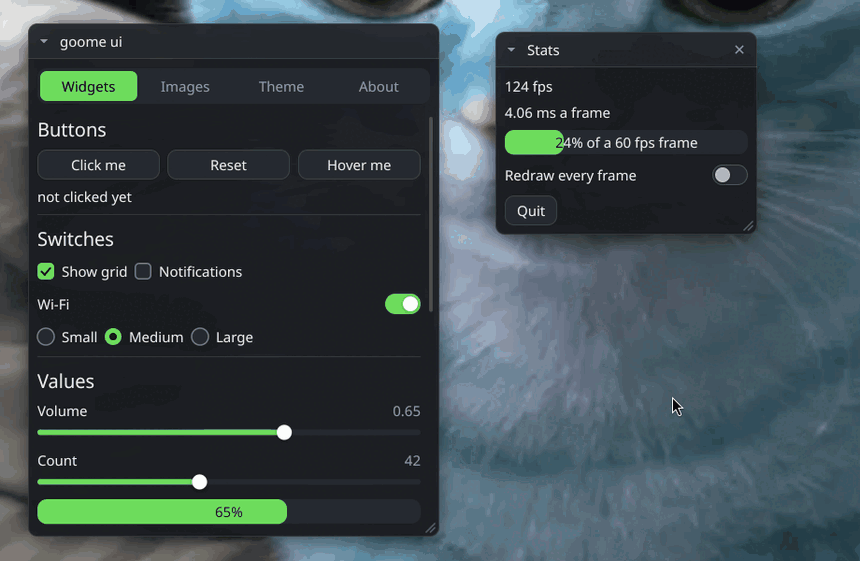
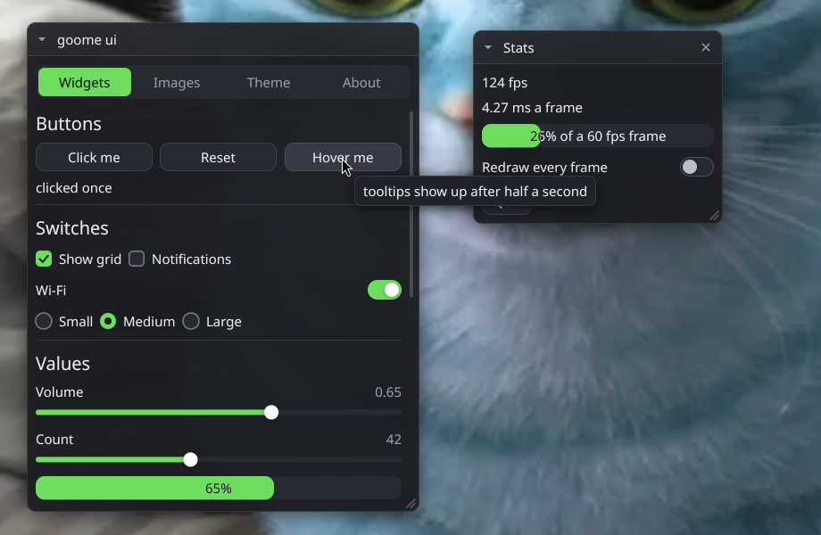

<p align="center">
  
</p>

<h1 align="center">🫠 csharp-goome 🫠</h1>

<p align="center">
<b>C# bindings for goome. See-through, always on top overlays from .NET on Linux, Windows and Mac.</b>
</p>

<p align="center">
  
  
  
  
  
</p>

<p align="center">
  This is <a href="https://github.com/goome-ui/c-goome">goome</a> for C#. It puts a see-through layer over every monitor, you draw on it, and only the bits you draw take clicks.<br>
  Its the real C library underneath (built as a shared lib and called with P/Invoke), wrapped so it feels like normal .NET with <code>using</code> blocks and <code>Span&lt;uint&gt;</code> pixels.
</p>

<p align="center">
  <br>
  <sub>the C ui demo running on my gnome desktop. its the same ui kit, and the C# port draws the exact same frames</sub>
</p>

<details>
<summary align="center"><b>⬇️ Get It ⬇️</b></summary>

<br>

<p align="center">
Its not on NuGet yet. For now clone it and build the native lib, you need a C compiler (gcc, clang, or mingw gcc on windows) and the .NET 8 SDK or newer.
</p>

```sh
git clone https://github.com/goome-ui/csharp-goome
cd csharp-goome
./build.sh                      # libgoome.so / libgoome.dylib into runtimes/<rid>/native/
./build.sh win                  # goome.dll with mingw, also works from linux
dotnet run --project examples/Hello
```

<p align="center">
Then reference <code>src/GoomeSharp/GoomeSharp.csproj</code> from your project, the native lib gets copied next to your app on its own.<br> <br>
Want a package instead? <code>dotnet pack src/GoomeSharp -c Release -o out</code> makes a .nupkg with every lib that is in <code>runtimes/</code>. CI builds all four (linux-x64, win-x64, osx-arm64, osx-x64) and uploads a nupkg with all of them as the <b>nupkg</b> artifact, grab it from the latest run and add it as a local source.
</p>
</details>

<details>
<summary align="center"><b>🚀 Quick Start 🚀</b></summary>

<br>

<p align="center">
A whole overlay that draws a box and prints clicks on it:
</p>

```csharp
using GoomeSharp;

using var g = new Goome(new GoomeOptions { Title = "my overlay" });
var pace = new Pacer();
while (true)
{
    int wait = pace.Pace(60);
    while (g.Poll(out var ev, wait))
    {
        if (ev.Type == EventType.Quit) return;
        if (ev.Type == EventType.Down) Console.WriteLine($"clicked at {ev.X:0},{ev.Y:0}");
        wait = pace.Pace(60);
    }

    var c = g.Begin(0); // monitor 0
    if (c == null) continue;
    c.DrawRoundRect(100, 100, 200, 80, 12, 0xE0202838);
    c.DrawText(116, 128, "click me", true, 0xFFFFFFFF);
    g.End(c, new Rect(100, 100, 200, 80)); // only this part takes clicks
}
```

<p align="center">
<code>new Goome()</code> throws a <code>GoomeException</code> when theres no overlay to be had (no display, nothing supported), its <code>Code</code> says why.
</p>
</details>

<details>
<summary align="center"><b>🎛️ UI Kit 🎛️</b></summary>

<br>

<p align="center">
goome's immediate mode ui, you keep your own variables and pass them by <code>ref</code> every frame:
</p>

```csharp
using var g = new Goome();
using var ui = new Ui(g);
using var logo = Bitmap.Load("logo.png");
double x = 40, y = 40, w = 300, h = 0, volume = 0.5; // h 0 = fit the content
bool loud = false;
string name = "goome";

for (bool running = true; running;)
{
    while (g.Poll(out var ev, 16))
    {
        if (ev.Type == EventType.Quit) running = false;
        ui.Feed(ev);
    }
    if (ui.Begin(0) == null) continue;
    if (ui.Window("Settings", ref x, ref y, ref w, ref h, WindowFlags.Move | WindowFlags.Collapse))
    {
        ui.Image(logo, 64, 64, 12);
        if (ui.Button("Say hi")) Console.WriteLine("hi");
        ui.Slider("Volume", ref volume, 0, 1, "%.2f");
        ui.Toggle("Loud", ref loud);
        ui.Input("Name", ref name);
    }
    ui.WindowEnd();
    ui.End();
}
```

<p align="center">
<code>ui.Theme</code> holds every color and size the kit uses, plus the font, and <code>ui.Theme.Light()</code> / <code>Dark()</code> flip the whole thing at once. You can also set single fields like <code>ui.Theme.Accent</code> or <code>ui.Theme.FontSize</code> if you only want your own accent color or a bigger font, they write straight into goome's theme.<br> <br>
The values are yours, not the widget's. If you change <code>volume</code> from somewhere else the slider just shows the new value next frame. Same for window position and size, which is how you save and restore a layout: write <code>x</code>, <code>y</code>, <code>w</code> and <code>h</code> somewhere and pass them back in next time.<br> <br>
<code>examples/UiDemo</code> shows off every widget, same as the C demo, and it's the easiest place to copy from.
</p>
</details>

<details>
<summary align="center"><b>📚 The API 📚</b></summary>

<br>

<p align="center">
Everything in goome.h is in there, just shaped like C#. If something can fail for a normal reason, like hotkeys on wayland or a grab that isn't ready yet, you get a bool or a <code>GoomeError</code> back and <code>g.LastError</code> has the details. Anything else throws <code>GoomeException</code>.
</p>

| | |
|:--|:--|
| `new Goome(options)` / `Dispose` | start and stop. After that `BackendName`, `Caps` and `Has(Caps.Hotkeys)` tell you what backend you actually got and what it can do |
| `g.Monitors` | every monitor with its spot, size, scale and rotation |
| `g.Begin` / `g.End` | get a monitor's `Canvas` and draw on it. Then hand it back with the `Rect`s that should take clicks |
| `g.Poll(out Event ev, ms)` | clicks, moves, scroll, keys, hotkeys, control lines, monitor changes, quit (`Event` is a struct so nothing gets allocated) |
| `g.Pointer` / `g.Keyboard` | mouse position. Keyboard is for when you need to take it for a bit |
| `g.Hotkey("alt+h", 1)` | system wide combo, `Goome.ParseCombo` checks one without grabbing |
| `g.ControlPath` / `Goome.Send` | control fifo, since wayland doesn't have hotkeys |
| `g.Capture` / `g.TryCapture` | grabs a monitor or a rect. `Image.Pixels` is a span right over goome's buffer and `ToArray()` copies it out |
| `g.AlphaAt` | is our overlay at this spot? |
| `Pacer`, `Goome.NowMs` | frame timing |
| `Canvas` | every `goome_draw_*`, plus clipping and bitmaps and text. `Pixels` is a `Span<uint>` and `Raw` is the struct itself |
| `Canvas.Create(w, h)` | your own canvas in memory, I use it for tests and offscreen stuff |
| `Bitmap.Load` / `FromArgb` / `Wrap` | loads PNG, JPEG, BMP, PPM or QOI from a file or from bytes |
| `Font.Load` / `Font.System` / `Font.BuiltIn` | real fonts, with `Measure` and `LineHeight` |
| `Ui` / `Theme` | ui kit |

<p align="center">
<code>Bitmap</code>, <code>Font</code>, <code>Canvas.Create</code>, <code>Ui</code> and <code>Goome</code> are all <code>IDisposable</code>. Disposing a <code>Goome</code> also disposes its <code>Ui</code>s, and using anything after that throws <code>ObjectDisposedException</code> instead of crashing.<br> <br>
Pixels from <code>Capture</code> belong to goome and are good until the next grab of that monitor. Canvas pixels are good until <code>End</code>.<br> <br>
Call it all from one thread, the one that made the <code>Goome</code>. On Mac that has to be the main thread.
</p>
</details>

<details>
<summary align="center"><b>🖥️ Where It Works 🖥️</b></summary>

<br>

<p align="center">
Wherever goome works: X11, wlroots and KDE Wayland, GNOME, Windows 10 / 11 and macOS 14+. The full table is in the <a href="https://github.com/goome-ui/c-goome#readme">c-goome README</a>.<br> <br>
CI builds the libs for linux-x64, win-x64, osx-arm64 and osx-x64. On anything else (linux arm64 etc) just run <code>./build.sh</code> there.<br> <br>
The lib gets found in <code>runtimes/&lt;rid&gt;/native/</code> or right next to your app. <code>GOOME_NATIVE=/some/folder</code> (or a full path to the lib) points it somewhere else.
</p>
</details>

<details>
<summary align="center"><b>📸 Screenshot 📸</b></summary>

<br>

<p align="center">
  <br>
  <sub>the ui kit at full size, just floating over my wallpaper</sub>
</p>
</details>

<details>
<summary align="center"><b>🧪 Testing Without A Screen 🧪</b></summary>

<br>

<p align="center">
goome has a <b>test</b> backend that fakes a whole screen and plays a script of clicks and keys. Set it in code:
</p>

```csharp
using var g = new Goome(new GoomeOptions
{
    Backend = Backend.Test,
    TestScript = "screen 640x360 1; 1 click 20,20; 2 key hi; end 5",
});
```

<p align="center">
or with env vars, no code changes at all:
</p>

```sh
GOOME_BACKEND=test GOOME_TEST_SHOTS=shots/ GOOME_TEST_SCRIPT="screen 1280x720 1; 3 click 100,150; end 10" dotnet run --project examples/UiDemo
```

<p align="center">
The script format is in the <a href="https://github.com/goome-ui/c-goome#readme">c-goome README</a>. The tests here run all of goome's own checks through C# (combos, a scripted run, grabs, the drawing, font, image and ui pixel hashes) plus the binding stuff like struct layouts and disposing:
</p>

```sh
./build.sh
dotnet run --project tests/GoomeSharp.Tests
```
</details>

<details>
<summary align="center"><b>🔧 Why net8.0 🔧</b></summary>

<br>

<p align="center">
goome has a C <code>long</code>, thats 8 bytes on linux and mac but 4 on windows, and .NET 8 is where <code>CLong</code> and <code>LibraryImport</code> showed up. Anything newer than 8 runs it fine.
</p>
</details>

<details>
<summary align="center"><b>🛠 Pull Requests 🛠</b></summary>

<br>

<p align="center">
Want to help? Make A pull request to <b>dev</b>!<br>
Small fixes are the easiest to merge, for anything bigger open an issue first. Bugs in goome itself go to <a href="https://github.com/goome-ui/c-goome">c-goome</a>, this repo only has a copy of it.<br> <br>
Read <a href="CONTRIBUTING.md">CONTRIBUTING.md</a> before you send one.
</p>
</details>

<details>
<summary align="center"><b>⚖️ License ⚖️</b></summary>

<br>

<p align="center">
csharp-goome is under the <a href="LICENSE">GPL-3.0</a>, same as goome.<br> <br>
<sub>
• You can use it, change it and share it<br>
• If you share something made with it, you have to share your source too, under the same license<br>
• Keep the credits
</sub><br> <br>
In short: play fair, keep it open, and give credit where it's due.
</p>
</details>

<details>
<summary align="center"><b>🩷 Donate 🩷</b></summary>

<br>

<p align="center">
<a href="https://sevvy-wevvy.com/kofi">Ko-fi</a> (Preferred)<br>
<a href="https://sevvy-wevvy.com/patreon">Patreon</a><br>
<a href="https://sevvy-wevvy.com/throne">Throne</a>
</p>
</details>
