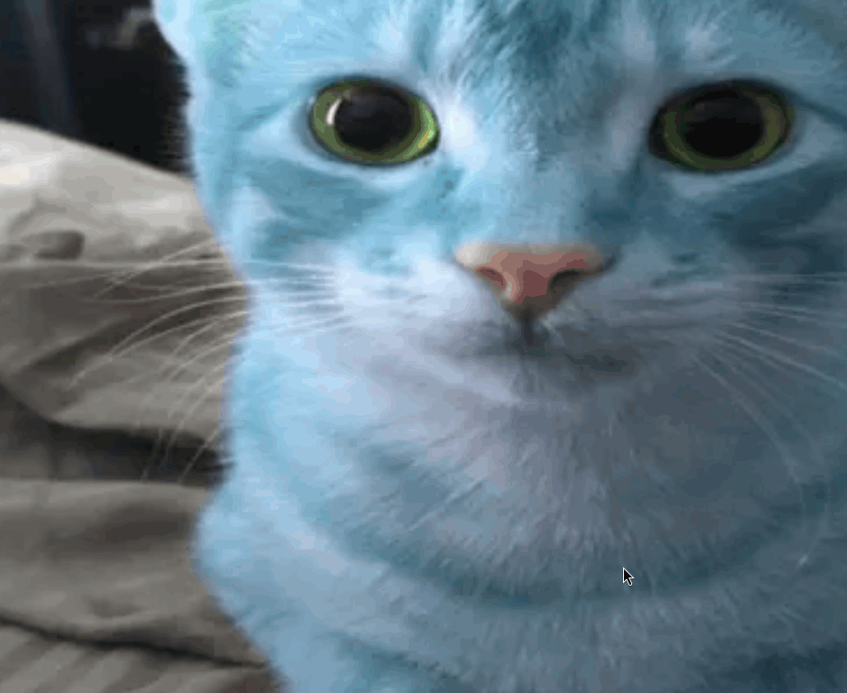
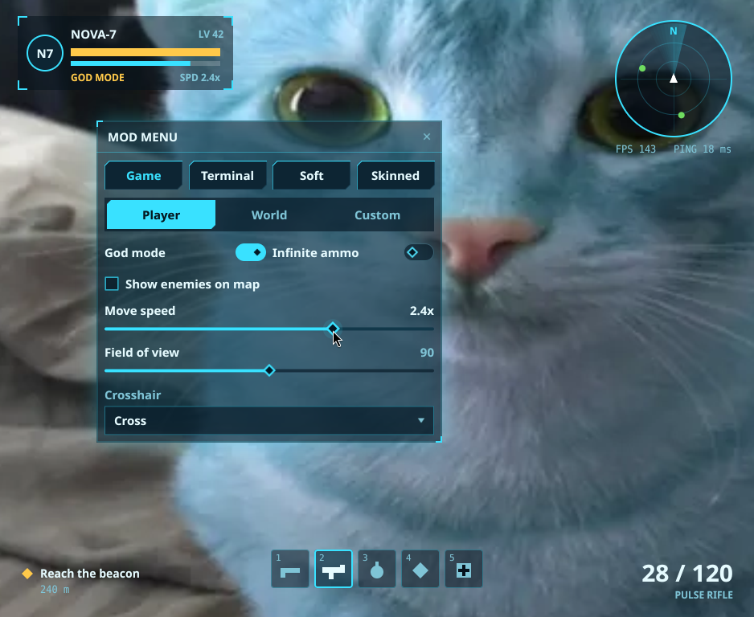

<p align="center">
  
</p>

<h1 align="center">🫠 csharp-goome 🫠</h1>

<p align="center">
<b>C# bindings for goome. See-through overlays, normal app windows, in game ui for Unity and mod menus for Unity games. Works from .NET on Linux, Windows or Mac.</b>
</p>

<p align="center">
  
  <a href="https://www.nuget.org/packages/GoomeSharp"></a>
  
  
  
  
  
</p>

<p align="center">
  <a href="https://goome.wtf/docs/"><b>📖 Docs</b></a> &nbsp;·&nbsp;
  <a href="https://goome.wtf/builder/"><b>🧱 Builder</b></a> &nbsp;·&nbsp;
  <a href="https://github.com/goome-ui/examples"><b>🧩 Examples</b></a> &nbsp;·&nbsp;
  <a href="https://github.com/goome-ui/c-goome">C</a> &nbsp;·&nbsp;
  <a href="https://github.com/goome-ui/python-goome">Python</a> &nbsp;·&nbsp;
  <a href="https://github.com/goome-ui/java-goome">Java</a> &nbsp;·&nbsp;
  <a href="https://github.com/goome-ui/godot-goome">Godot</a>
</p>

<p align="center">
  To see what goome can do, grab one of the <a href="https://goome.wtf/docs/downloads/">ready made apps</a>, like the HUD or the crosshair. To start your own, <code>goome new my-app --lang csharp</code> from <a href="https://github.com/goome-ui/goome-cli">goome-cli</a> makes it from a <a href="https://goome.wtf/docs/templates/">template</a>.<br>
  Questions go in <a href="https://github.com/goome-ui/c-goome/discussions">Discussions</a>. If you want to help, the <a href="https://github.com/goome-ui/csharp-goome/labels/good%20first%20issue">good first issues</a> are small ones to start with.
</p>

<p align="center">
  This is <a href="https://github.com/goome-ui/c-goome">goome</a> for C#. Same ui kit for click-through overlays and plain app windows. It can draw into a Unity texture too, and <code>mods/</code> has mod menu templates for BepInEx and MelonLoader.<br>
  Its the real C library underneath (built as a shared lib and called with P/Invoke), wrapped so it feels like normal .NET with <code>using</code> blocks and <code>Span&lt;uint&gt;</code> pixels.<br> <br>
  The docs are at <a href="https://goome.wtf/docs/">goome.wtf/docs</a>. If you'd rather drag widgets around than write them, the <a href="https://goome.wtf/builder/">ui builder</a> spits out the code. <a href="https://github.com/goome-ui/examples">goome-ui/examples</a> has a pile of small real projects, C# ones included.<br> <br>
  Same library from other languages: <a href="https://github.com/goome-ui/c-goome">C</a>, <a href="https://github.com/goome-ui/python-goome">Python</a>, <a href="https://github.com/goome-ui/java-goome">Java</a> (with Fabric and NeoForge mods) and <a href="https://github.com/goome-ui/godot-goome">Godot</a>.
</p>

<h3 align="center">🪟 Overlay on top of everything</h3>

<p align="center">
The default. A see-through layer over the whole desktop, only the window takes clicks:
</p>

```csharp
using GoomeSharp;

using var g = new Goome();
using var ui = new Ui(g);
double x = 40, y = 40, w = 260, h = 0;
for (bool on = true; on;)
{
    while (g.Poll(out var ev, 16)) { if (ev.Type == EventType.Quit) on = false; ui.Feed(ev); }
    if (ui.Begin(0) == null) continue;
    if (ui.Window("Hi", ref x, ref y, ref w, ref h, WindowFlags.Move) && ui.Button("Click me")) Console.WriteLine("hi");
    ui.WindowEnd();
    ui.End();
}
```

<h3 align="center">📝 Make a normal app</h3>

<p align="center">
A real window with a title bar, you can resize it, move it around or minimize it. <code>GoomeApp.Run</code> does the whole loop for you and only redraws when something changed:
</p>

```csharp
using GoomeSharp;

string name = "";
GoomeApp.Run("My app", 960, 640, ui =>
{
    ui.Heading("Hello");
    ui.Input("Name", ref name);
    if (ui.Button("Say hi")) ui.Toast($"hi {name}");
});
```

<h3 align="center">🎮 Inside Unity or a game engine</h3>

<p align="center">
Package Manager > + > Add package from git URL:
</p>

```
https://github.com/goome-ui/csharp-goome.git?path=/unity/com.goome-ui.goome
```

<p align="center">
Then put a <code>GoomeView</code> on a RawImage and draw from <code>view.Draw += ui => { ... }</code>. goome renders offscreen into a texture and takes the mouse and keys from Unity. Clicks that miss the ui fall through to the game. Any other engine works too with <code>Goome.OpenOffscreen</code>, <code>Push</code> and <code>Frame</code>, more on that below and in the <a href="unity/com.goome-ui.goome">package README</a>.
</p>

<h3 align="center">🧩 Mod menu for a Unity game</h3>

<p align="center">
Grab the template for your loader from <code>mods/templates</code>, build it and copy its <code>dist/</code> folder into the game. F8 opens a sample menu. Your own menu is just a Draw hook:
</p>

```csharp
var mod = new GoomeMod("my.mod", "F8", pluginFolder);
mod.Draw += ui =>
{
    if (ui.Window("My mod", ref x, ref y, ref w, ref h, WindowFlags.Move))
    {
        ui.Toggle("Fly", ref fly);
        ui.Slider("Speed", ref speed, 1, 10);
    }
    ui.WindowEnd();
};
```

<p align="center">
The game doesnt get clicks or keys while the menu wants them. Mono and IL2CPP both build, the <a href="mods">mods README</a> has the install steps per loader. Single player only, anti-cheat will ban you for the input patches.
</p>

<p align="center">
  <br>
  <sub>a notes app, a stream overlay and a mod menu, running on my gnome desktop. the desktop behind the overlays still works</sub>
</p>

<details>
<summary align="center"><b>⬇️ Get It ⬇️</b></summary>

<br>

```sh
dotnet add package GoomeSharp
```

<p align="center">
Its on <a href="https://www.nuget.org/packages/GoomeSharp">NuGet</a> and the package has the native lib for every OS inside, so theres nothing to build. Every <a href="https://github.com/goome-ui/csharp-goome/releases">release</a> also has the .nupkg if you want it offline, put it in a folder and <code>dotnet add package GoomeSharp --source ./that-folder</code>.
</p>

<p align="center">
Or build it from source. Clone it and build the native lib, you need a C compiler (gcc, clang, or mingw gcc on windows) and the .NET 8 SDK or newer.
</p>

```sh
git clone https://github.com/goome-ui/csharp-goome
cd csharp-goome
./build.sh                      # libgoome.so / libgoome.dylib into runtimes/<rid>/native/
./build.sh win                  # goome.dll with mingw, also works from linux
dotnet run --project examples/Hello
```

<p align="center">
Then reference <code>src/GoomeSharp/GoomeSharp.csproj</code> from your project, the native lib gets copied next to your app on its own.<br> <br>
Want your own package? <code>dotnet pack src/GoomeSharp -c Release -o out</code> makes a .nupkg with every lib that is in <code>runtimes/</code>.
</p>

<h3 align="center">📦 Other Versions</h3>

<p align="center">
<code>dotnet add package GoomeSharp --version 0.4.0</code> pins one. NuGet has 0.4.0 and up, the older ones are .nupkg files on the releases page. For Unity put the tag on the end of the git URL (the package is there from 0.2.0 on):
</p>

```
https://github.com/goome-ui/csharp-goome.git?path=/unity/com.goome-ui.goome#v0.5.3
```

<p align="center">
The <a href="https://github.com/goome-ui/csharp-goome/releases">releases page</a> has every version. 0.3.0 also has the Unity package as a .tgz (Package Manager > + > Add package from tarball) and ready to drop in zips of the mod menu template for BepInEx 5, BepInEx 6 and MelonLoader (Mono games).
</p>
</details>

<details>
<summary align="center"><b>🚀 Quick Start 🚀</b></summary>

<br>

<p align="center">
A whole overlay that draws a box and prints clicks on it:
</p>

```csharp
using GoomeSharp;

using var g = new Goome(new GoomeOptions { Title = "my overlay" });
var pace = new Pacer();
while (true)
{
    int wait = pace.Pace(60);
    while (g.Poll(out var ev, wait))
    {
        if (ev.Type == EventType.Quit) return;
        if (ev.Type == EventType.Down) Console.WriteLine($"clicked at {ev.X:0},{ev.Y:0}");
        wait = pace.Pace(60);
    }

    var c = g.Begin(0); // monitor 0
    if (c == null) continue;
    c.DrawRoundRect(100, 100, 200, 80, 12, 0xE0202838);
    c.DrawText(116, 128, "click me", true, 0xFFFFFFFF);
    g.End(c, new Rect(100, 100, 200, 80)); // only this part takes clicks
}
```

<p align="center">
<code>new Goome()</code> throws a <code>GoomeException</code> when there's no overlay to be had (no display, nothing supported), its <code>Code</code> says why.
</p>
</details>

<details>
<summary align="center"><b>🎛️ UI Kit 🎛️</b></summary>

<br>

<p align="center">
goome's immediate mode ui, you keep your own variables and pass them by <code>ref</code> every frame:
</p>

```csharp
using var g = new Goome();
using var ui = new Ui(g);
using var logo = Bitmap.Load("logo.png");
double x = 40, y = 40, w = 300, h = 0, volume = 0.5; // h 0 = fit the content
bool loud = false;
string name = "goome";

for (bool running = true; running;)
{
    while (g.Poll(out var ev, 16))
    {
        if (ev.Type == EventType.Quit) running = false;
        ui.Feed(ev);
    }
    if (ui.Begin(0) == null) continue;
    if (ui.Window("Settings", ref x, ref y, ref w, ref h, WindowFlags.Move | WindowFlags.Collapse))
    {
        ui.Image(logo, 64, 64, 12);
        if (ui.Button("Say hi")) Console.WriteLine("hi");
        ui.Slider("Volume", ref volume, 0, 1, "%.2f");
        ui.Toggle("Loud", ref loud);
        ui.Input("Name", ref name);
    }
    ui.WindowEnd();
    ui.End();
}
```

<p align="center">
<code>ui.Theme</code> holds every color and size the kit uses, plus the font, and <code>ui.Theme.Light()</code> / <code>Dark()</code> flip the whole thing at once. You can also set single fields like <code>ui.Theme.Accent</code> or <code>ui.Theme.FontSize</code> if you only want your own accent color or a bigger font, they write straight into goome's theme.<br> <br>
The values are yours, not the widgets. If you change <code>volume</code> from somewhere else the slider just shows the new value next frame. Same for window position and size, which is how you save and restore a layout: write <code>x</code>, <code>y</code>, <code>w</code> and <code>h</code> somewhere and pass them back in next time.<br> <br>
<code>examples/UiDemo</code> shows off every widget, same as the C demo, and it's the easiest place to copy from.<br> <br>
Some Begin calls need their End every time and some only when they returned true, same as in C, the <a href="https://goome.wtf/docs/ui-app/">docs</a> list which is which.
</p>
</details>

<details>
<summary align="center"><b>🎨 Changing The Look 🎨</b></summary>

<br>

<p align="center">
Start with a preset, or <code>ui.Theme.Make(accent)</code> if you just want your own color on everything. When one button needs to look different, wrap it in <code>ui.Style(...)</code> and it goes back to normal after the <code>using</code>.
</p>

```csharp
ui.Theme.Preset(Preset.Midnight);
using (ui.Style(radius: 99, accent: 0xFFF59E0B)) ui.Button("Pill");
```

<p align="center">
Theres a lot more you can change, like your own widgets with <code>ui.Custom</code> or png icons and skins. It's all in the <a href="https://goome.wtf/docs/">docs</a>, and <code>examples/Skinned</code> is a full reskinned app if you'd rather read code.
</p>
</details>

<details>
<summary align="center"><b>📝 Apps 📝</b></summary>

<br>

<p align="center">
<code>GoomeApp</code> is the WinForms-ish way in. It opens the window, runs the loop, waits for input when nothing moves and draws again when something does. Your lambda runs inside the app root, so menus, the status bar and modals all just work:
</p>

```csharp
using var app = new GoomeApp("Notes", 960, 640) { Flags = AppFlags.MenuBar | AppFlags.StatusBar };
bool about = false;
app.OnClose = () => true; // false keeps the window open, like asking about unsaved stuff first
app.Run(ui =>
{
    if (ui.MenuBarBegin())
    {
        if (ui.MenuBegin("Help"))
        {
            if (ui.MenuItem("About")) about = true;
            ui.MenuEnd();
        }
        ui.MenuBarEnd();
    }
    if (about && ui.ModalBegin("About", ref about))
    {
        ui.Label("made with goome");
        ui.ModalEnd();
    }
    ui.StatusBar("ready");
});
```

<p align="center">
<code>examples/App</code> is a whole little notes app with a menubar and a sidebar, plus a settings modal.<br> <br>
Want the loop yourself? <code>Goome.OpenApp("title", 960, 640)</code> gives you the window as a normal <code>Goome</code>, then it works like the overlay code above. The window is monitor 0, resizing sends <code>EventType.Monitors</code>, the close button sends <code>EventType.Close</code> (goome doesnt close by itself, you decide), and theres <code>EventType.Focus</code> and <code>EventType.Drop</code> for dropped files (<code>g.DropPath</code> has the full path).
</p>
</details>

<details>
<summary align="center"><b>🎮 Offscreen And Engines 🎮</b></summary>

<br>

<p align="center">
Offscreen mode has no window and no threads. You push input in, goome draws, you take the pixels out:
</p>

```csharp
using var g = Goome.OpenOffscreen(800, 600, scale: 1);
using var ui = new Ui(g);
g.Push(Event.Down(120, 80));
g.Push(Event.Up(120, 80));
g.PushText("typed in");
while (g.Poll(out var ev)) ui.Feed(ev);
ui.Begin(0);
// widgets
ui.End();
var frame = g.Frame();          // premultiplied argb, frame.Pixels or frame.Pointer for a texture upload
if (g.FrameDirty(out var r))    // only the part that changed since last time
    g.FrameCopy(buf.AsSpan(r.Y * stride + r.X * 4), stride, Format.Rgba, r); // into your own buffer, Format.Bgra etc unpremultiply
bool onUi = g.Hit(120, 80);     // did that spot hit the ui, or should the game get it
var cursor = g.Cursor;          // what cursor the ui wants right now
g.Resize(1024, 768, 2);         // new size or scale
```

<p align="center">
The clipboard is just a string goome keeps, sync it with <code>g.Clipboard</code> both ways. <code>examples/Offscreen</code> renders the ui into a PPM with scripted clicks and typing.<br> <br>
The Unity package in <code>unity/com.goome-ui.goome</code> does all of that for you with a MonoBehaviour, see its <a href="unity/com.goome-ui.goome">README</a>. Writing a C or C++ engine instead? c-goome has <a href="https://github.com/goome-ui/c-goome/tree/main/backends">backends</a> that draw the frame with DirectX, Vulkan, Metal or OpenGL. Godot has its own node in <a href="https://github.com/goome-ui/godot-goome">godot-goome</a>.
</p>
</details>

<details>
<summary align="center"><b>🖱️ Taking The Mouse And Keys 🖱️</b></summary>

<br>

<p align="center">
When you drag a slider or a window over a game, the ui grabs the mouse by itself for the whole drag and gives it back when you let go, so the camera doesnt turn. A plain button click doesnt grab. Text boxes take the keyboard while they have focus.<br> <br>
If you put goome in your own engine, ask it what it wants every frame:
</p>

```csharp
ui.End();
if (ui.WantsMouse) { }          // over the ui, mid drag, or a popup is open, don't do mouse look
if (ui.WantsKeyboard) { }       // a text box has focus, dont move the player
Want w = ui.Wants;              // both as flags
ui.AutoGrab = Want.Keyboard;    // stop the ui grabbing the mouse by itself, Want.None for nothing
g.Grab(true);                   // grab it yourself, g.Grabbed tells you if it is
```

<p align="center">
On windows, x11 or mac the grab takes focus from the game so its raw input stops too (<code>Caps.Grab</code> says you get a real pointer grab). On wayland it can only take the keyboard focus. Offscreen just remembers it, so read <code>ui.Wants</code> there.
</p>
</details>

<details>
<summary align="center"><b>🌀 Animations 🌀</b></summary>

<br>

<p align="center">
<code>ui.Anim</code> gives you a number that slides toward the target you pass it, and remembers where it was by id. Change the target and it moves there over the time you gave it. <code>ui.AnimColor</code> is the same thing for colors. While something is still moving <code>ui.Animating</code> is true, so you know to draw another frame.
</p>

```csharp
double x = ui.Anim("panel", open ? 240 : 0, 300, Ease.Spring);
uint col = ui.AnimColor("dot", busy ? 0xFFE0483E : 0xFF21A66B, 200, Ease.InOut);
double half = Ease.Bounce.At(0.5);
```

<p align="center">
Theres Linear, In, Out, InOut, Smooth, Back, Spring and Bounce. Spring and Back go a little past the end before they settle. <code>examples/Anim</code> shows every one of them next to each other.
</p>
</details>

<details>
<summary align="center"><b>⌨️ IME Typing ⌨️</b></summary>

<br>

<p align="center">
Japanese, Chinese, Korean and dead keys all work in inputs and <code>TextEdit</code>. When a text box gets focus the ui turns the IME on and puts its window next to the caret, then the half typed text shows underlined until you pick something.<br> <br>
In your own engine you push it in yourself. <code>PushPreedit</code> is the text thats still being composed, <code>PushCommit</code> is the finished text (any length, it splits it up for you):
</p>

```csharp
g.PushPreedit("にほ", caret: 2);
g.PushPreedit("");
g.PushCommit("日本");
while (g.Poll(out var ev))
    if (ev.Type == EventType.Text) Console.WriteLine(ev.Message);
g.TextInput(true, new Rect(40, 60, 1, 18));
```

<p align="center">
<code>ev.Message</code> has the whole text for Text and Preedit events, not just the first 63 bytes, and <code>ev.Caret</code> is a normal C# string index. The Unity <code>GoomeView</code> does all of this for you from <code>Input.compositionString</code> or the Input System's IME events.
</p>
</details>

<details>
<summary align="center"><b>🦻 Screen Readers 🦻</b></summary>

<br>

<p align="center">
The ui builds a tree of everything on screen each frame, with roles, labels, values and states like focused or checked. In window mode goome hands it to the OS screen reader by itself. Offscreen its off, turn it on with <code>ui.A11y(true)</code> and read it after <code>End</code> to feed your engine's own accessibility stuff:
</p>

```csharp
ui.A11y(true);
foreach (var n in ui.AccessibilityTree())
    Console.WriteLine($"{n.Role} {n.Label} {n.Value} parent {n.Parent} focused {n.Focused}");
ui.A11yPerform(A11yAction.Press, okButton.Id);
ui.A11yRole(Role.Button, "Knob");
ui.A11yValue("11");
ui.Custom("knob", 40, 40, ItemFlags.None, out var it);
```

<p align="center">
<code>A11yPerform</code> does press, set, expand and focus the same way a screen reader would. <code>A11yRole</code> and <code>A11yValue</code> name your own <code>ui.Custom</code> widgets so they dont show up as nothing. In Unity, <code>GoomeView.GetAccessibilityTree()</code> gives you the same nodes and <code>TryGetScreenRect</code> says where each one is on screen.
</p>
</details>

<details>
<summary align="center"><b>😀 Emoji And RTL 😀</b></summary>

<br>

<p align="center">
Color emoji work (COLR, CBDT and sbix fonts), with skin tones, ZWJ families and flags. Arabic gets joined up properly and Hebrew and Arabic go right to left, mixed with english in the same line too. <code>Font.System()</code> already adds the system emoji font, for your own fonts add a fallback:
</p>

```csharp
using var font = Font.Load("myfont.ttf");
using var emoji = Font.Load("NotoColorEmoji.ttf");
font.Fallback(emoji);
Font.Direction = TextDirection.Rtl;
```

<p align="center">
<code>Font.Direction</code> is for all text, Auto (the default) picks it per line from the first real letter. <code>examples/Text</code> has emoji, Arabic and Hebrew lines plus inputs you can type RTL in.
</p>
</details>

<details>
<summary align="center"><b>📚 The API 📚</b></summary>

<br>

<p align="center">
Everything in goome.h is in there, just shaped like C#. If something can fail for a normal reason, like hotkeys on wayland or a grab that isnt ready yet, you get a bool or a <code>GoomeError</code> back and <code>g.LastError</code> has the details. Anything else throws <code>GoomeException</code>.
</p>

| | |
|:--|:--|
| `new Goome(options)` / `Dispose` | start and stop. After that `BackendName`, `Caps` and `Has(Caps.Hotkeys)` tell you what backend you actually got and what it can do. `options.Mode` picks overlay, window or offscreen |
| `Goome.OpenApp` / `Goome.OpenOffscreen` / `GoomeApp` | shortcuts. `GoomeApp.Run` even runs the loop for you |
| `g.SetTitle` / `SetSize` / `SetPosition` / `SetState` / `Drag` / `Show` | window control. `Drag(Edges.None)` starts a native move from the click thats happening, for your own title bar |
| `g.Cursor` / `g.Clipboard` / `g.DropPath` | set the cursor shape, read or write the clipboard (`GetClipboard` / `SetClipboard` if you want to know when it failed), get the whole path of a dropped file |
| `g.Push` / `g.Resize` / `g.Frame` / `g.Hit` | feed events in (`Event.Down`, `Event.Char`, `PushText`...), resize offscreen, read the finished frame, hit test |
| `g.Monitors` | every monitor with its spot and size, plus its scale and rotation |
| `g.Begin` / `g.End` | get the `Canvas` of a monitor and draw on it. Then hand it back with the `Rect`s that should take clicks |
| `g.Poll(out Event ev, ms)` | clicks, moves, scroll, keys, hotkeys, control lines, monitor changes, quit (`Event` is a struct so nothing gets allocated) |
| `g.Pointer` / `g.Keyboard` | mouse position. Keyboard is for when you need to take it for a bit |
| `g.Grab` / `g.Grabbed` | take the mouse (and focus) from the game until `Grab(false)` |
| `ui.Wants` / `WantsMouse` / `WantsKeyboard` / `AutoGrab` | does the ui want the mouse or keys right now, and what it grabs by itself |
| `g.Hotkey("alt+h", 1)` | system wide combo, `Goome.ParseCombo` checks one without grabbing |
| `g.ControlPath` / `Goome.Send` | control fifo, since wayland doesnt have hotkeys |
| `g.Capture` / `g.TryCapture` | grabs a monitor or a rect. `Image.Pixels` is a span right over goome's buffer and `ToArray()` copies it out |
| `g.AlphaAt` | tells you if the overlay covers a spot |
| `Pacer`, `Goome.NowMs` | for timing frames |
| `Canvas` | every `goome_draw_*`, plus clipping and bitmaps and text. `Pixels` is a `Span<uint>` and `Raw` is the struct itself |
| `Canvas.Create(w, h)` | a canvas of your own in memory |
| `Bitmap.Load` / `FromArgb` / `Wrap` | loads PNG, JPEG, BMP, PPM or QOI from a file or from bytes |
| `Font.Load` / `Font.System` / `Font.BuiltIn` | real fonts, with `Measure` and `LineHeight` |
| `Ui` / `Theme` | the ui kit, see the next rows for whats in it |
| windows and basics | windows, buttons, sliders, inputs, combos, tabs, a color picker |
| app stuff | `App`, menubar and menus, context menus, popups, modals, toasts, status bar, keyboard focus |
| bigger widgets | multiline `TextEdit`, tables, trees, `ListClip` for long lists, split panes |
| small extras | drag numbers, plots from a `float[]`, drag-and-drop, spinners, links, badges |
| `Canvas.DrawBitmapNine` | draws a nine-slice bitmap, handy for skins |
| `Theme.ButtonSkin` / `Theme.Skins[SkinKind.Tab]` and the rest | give buttons, panels, tabs or any other part a nine-slice bitmap, `new Skin(bitmap, border)` |
| `Theme.Icons[Icon.Close]` / `IconTint` / `PushIcon` | swap any built in glyph (arrows, check, close, resize grip, knobs...) for a bitmap |
| `ui.Style(...)` / `PushColor` / `PushNum` / `PushRadii` / `PushFont` / `PushSkin` / `PushIcon` / `PushTheme` / `Pop` | change the look for the widgets in between |
| `ui.Custom` / `Canvas()` / `Store` / `Pos` / `Size` | your own widgets, drawn by you, placed wherever |
| `Theme.Make` / `Theme.Preset` / `ui.Scale` | a whole theme from one accent color, the 7 presets, everything bigger or smaller |
| `ui.Config` / `Config.Bind` | timings, toggles, cursors, the key map and a custom ease |
| `ui.InputEx` / `ui.Password` | inputs with a hint, password dots, read only, numbers only, enter to submit |
| `g.FrameDirty` / `g.FrameCopy` | what changed in the last frame, and copying it out as BGRA or RGBA |
| `ui.Anim` / `ui.AnimColor` / `Ease.Spring.At(t)` | values and colors that slide to a target, and the ease curves by themselves |
| `g.PushCommit` / `g.PushPreedit` / `g.TextInput` / `g.EventText` | IME text in and out, `EventType.Text` and `EventType.Preedit` events |
| `ui.A11y` / `AccessibilityTree` / `A11yPerform` / `A11yRole` / `A11yValue` | the screen reader tree and its actions |
| `font.Fallback` / `Font.Direction` | more fonts for missing chars like emoji, and LTR / RTL / Auto for text |

<p align="center">
<code>Bitmap</code>, <code>Font</code>, <code>Canvas.Create</code>, <code>Ui</code> and <code>Goome</code> are all <code>IDisposable</code>. Disposing a <code>Goome</code> also disposes its <code>Ui</code>s, and using anything after that throws <code>ObjectDisposedException</code>, it wont crash.<br> <br>
Pixels from <code>Capture</code> belong to goome and are good until the next grab of that monitor. Canvas pixels are good until <code>End</code>.<br> <br>
Call it all from one thread, the one that made the <code>Goome</code>. On Mac that has to be the main thread.
</p>
</details>

<details>
<summary align="center"><b>🖥️ Where It Works 🖥️</b></summary>

<br>

<p align="center">
Wherever goome works: X11, wlroots or KDE Wayland, GNOME, Windows 10 / 11, macOS 14+. The full table is in the <a href="https://github.com/goome-ui/c-goome#readme">c-goome README</a>.<br> <br>
CI builds the libs for linux-x64, win-x64, osx-arm64 and osx-x64. On anything else (linux arm64 etc) just run <code>./build.sh</code> there.<br> <br>
The lib gets found in <code>runtimes/&lt;rid&gt;/native/</code> or right next to your app. <code>GOOME_NATIVE=/some/folder</code> (or a full path to the lib) points it somewhere else.
</p>
</details>

<details>
<summary align="center"><b>📸 Screenshot 📸</b></summary>

<br>

<p align="center">
  <br>
  <sub>the ui kit at full size, just floating over my wallpaper</sub>
</p>
</details>

<details>
<summary align="center"><b>🧪 Testing Without A Screen 🧪</b></summary>

<br>

<p align="center">
goome has a <b>test</b> backend that fakes a whole screen and plays a script of clicks and keys. Set it in code:
</p>

```csharp
using var g = new Goome(new GoomeOptions
{
    Backend = Backend.Test,
    TestScript = "screen 640x360 1; 1 click 20,20; 2 key hi; end 5",
});
```

<p align="center">
or with env vars, no code changes at all:
</p>

```sh
GOOME_BACKEND=test GOOME_TEST_SHOTS=shots/ GOOME_TEST_SCRIPT="screen 1280x720 1; 3 click 100,150; end 10" dotnet run --project examples/UiDemo
```

<p align="center">
The script format is in the <a href="https://github.com/goome-ui/c-goome#readme">c-goome README</a>, and it does window mode too (<code>resize 400x300</code>, <code>close</code>, <code>focus 0</code>, <code>drop x,y path</code>). The tests here run all of goome's own checks through C#: combos, a scripted run, grabs, every pixel hash from the drawing to the ui kit, offscreen mode, window mode. On top of that come the binding checks, like the struct layouts or disposing, and a bunch of scripted ui sessions (menus, focus, the text editor, tables, drag-and-drop) whose frames have to hash exactly like the same session done in C:
</p>

```sh
./build.sh
dotnet run --project tests/GoomeSharp.Tests
```
</details>

<details>
<summary align="center"><b>🔧 Why Two Targets 🔧</b></summary>

<br>

<p align="center">
The package has <code>net8.0</code> for normal .NET apps and <code>netstandard2.1</code> because thats what Unity runs. Its the same source for both. Every P/Invoke only passes plain numbers and pointers (strings get turned into UTF-8 by hand), so it works the same everywhere (.NET 8, Mono, IL2CPP) with nothing generated, and it stays AOT friendly.<br> <br>
The one C <code>long</code> in goome (8 bytes on linux and mac, 4 on windows) is a <code>CLong</code> on net8.0 and gets read the right way per OS on netstandard2.1. The code sticks to C# 9 so the Unity compiler takes it.
</p>
</details>

<details>
<summary align="center"><b>🛠 Pull Requests 🛠</b></summary>

<br>

<p align="center">
Want to help? Make A pull request to <b>dev</b>!<br>
Small fixes are the easiest to merge, for anything bigger open an issue first. Bugs in goome itself go to <a href="https://github.com/goome-ui/c-goome">c-goome</a>, this repo only has a copy of it.<br> <br>
Read <a href="CONTRIBUTING.md">CONTRIBUTING.md</a> before you send one.
</p>
</details>

<details>
<summary align="center"><b>⚖️ License ⚖️</b></summary>

<br>

<p align="center">
csharp-goome is under the <a href="LICENSE">GPL-3.0</a>, same as goome.<br> <br>
<sub>
• You can use it, change it and share it<br>
• If you share something made with it, you have to share your source too, under the same license<br>
• Keep the credits
</sub><br> <br>
In short: play fair, keep it open, and give credit where it's due.
</p>
</details>

<details>
<summary align="center"><b>🩷 Donate 🩷</b></summary>

<br>

<p align="center">
<a href="https://sevvy-wevvy.com/kofi">Ko-fi</a> (Preferred)<br>
<a href="https://sevvy-wevvy.com/patreon">Patreon</a><br>
<a href="https://sevvy-wevvy.com/throne">Throne</a>
</p>
</details>

<p align="center">
<b>🫶 Contributors 🫶</b><br>
Thanks to everyone who helped out!<br> <br>
<a href="https://github.com/goome-ui/csharp-goome/graphs/contributors"></a>
</p>
